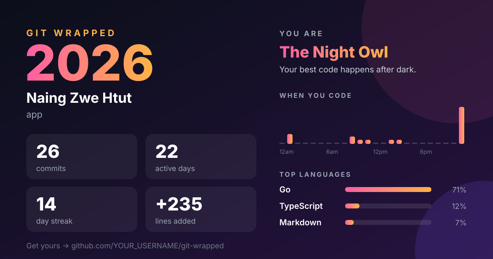

<div align="center">

# git-wrapped

**Your year in code, Spotify Wrapped style.**

Run one command in any git repo and get your commits, streaks, busiest hours, top languages,<br>
your coder personality, and a shareable card. Runs 100% locally. No login, no tokens, no upload.



[Install](#install) · [Usage](#usage) · [Personalities](#which-coder-are-you) · [Contributing](#contributing)

</div>

---

## Why

Web "year in review" tools only see public GitHub activity. `git-wrapped` reads your local git history, so it works on
**private work repos, GitLab, Bitbucket, self-hosted, or anything with a `.git` folder**, and nothing ever leaves your machine.

It ships in **three languages with identical output**: Go, Python and JavaScript. Use whichever you already have installed.

## Install

Pick one. None of them have dependencies.

**Go** (single binary)

```sh
go install github.com/Naingzwehtut/git-wrapped/go/cmd/git-wrapped@latest
```

Or grab a prebuilt binary for macOS, Linux or Windows from [Releases](https://github.com/Naingzwehtut/git-wrapped/releases).

**Python** (3.8+)

```sh
pipx install "git+https://github.com/Naingzwehtut/git-wrapped#subdirectory=python"
```

**JavaScript** (Node 18+)

```sh
git clone https://github.com/Naingzwehtut/git-wrapped
npm install -g ./git-wrapped/js
```

## Usage

```sh
git-wrapped                        # your commits this year, in the current repo
git-wrapped ~/code                 # every repo under ~/code (searched 3 levels deep)
git-wrapped --svg wrapped.svg      # also save the 1200x630 share card
git-wrapped --year 2025            # a different year
git-wrapped --everyone             # the whole team, not just you
git-wrapped --author "naing"       # match author name or email
git-wrapped --json                 # raw stats for your own scripts
```

By default it counts commits whose author email matches `git config user.email`. If you've committed under several
emails, use `--author` with a part they share.

### Sharing your card

The card is an SVG. To post it on X, LinkedIn or Bluesky, convert it to PNG:

```sh
rsvg-convert wrapped.svg -o wrapped.png      # brew install librsvg / apt install librsvg2-bin
```

Or just open the SVG in your browser and take a screenshot.

## What it measures

| Stat | How |
| --- | --- |
| Commits, active days | Non-merge commits on all branches and tags, deduplicated across repos |
| Lines added / deleted | From `git log --numstat`. Lockfiles, `node_modules/` and `vendor/` are ignored |
| Longest streak | Most consecutive calendar days with at least one commit |
| Busiest hour / weekday / day | In **your local time when you committed**, not UTC |
| Top languages | Lines changed per file extension |
| Most edited files | Files touched by the most commits |

The year is decided by each commit's author date in its own timezone, so a commit at 11:30pm on Dec 31 counts for that year wherever you were.

## Which coder are you?

| Personality | You get it when... |
| --- | --- |
| 🦉 The Night Owl | 30%+ of commits between 10pm and 4am |
| 🐦 The Early Bird | 25%+ of commits between 5am and 9am |
| ⚔️ The Weekend Warrior | 30%+ of commits on Saturday or Sunday |
| 🧹 The Code Janitor | You deleted more lines than you added |
| 🤖 The Commit Machine | 8+ commits per active day on average |
| 🐛 The Bug Hunter | 30%+ of commit messages mention "fix" or "bug" |
| 🚢 The Steady Shipper | None of the above. Consistent and reliable |

Checked in that order; first match wins. Want a new one? [Open an issue](https://github.com/Naingzwehtut/git-wrapped/issues).

## Project layout

```
go/        Go version       (go/cmd/git-wrapped)
python/    Python version   (python/src/git_wrapped)
js/        JavaScript       (js/src, js/bin)
tests/     fixture repos + golden files shared by all three
SPEC.md    the exact rules every version follows
```

All three versions follow [SPEC.md](SPEC.md) and must produce **byte-identical** terminal output, JSON and SVG.
CI enforces this by running each one against the same fixture repos and comparing with `tests/golden/`.

## Contributing

PRs are welcome, especially new personalities, card themes and language mappings.

1. Change the behaviour in **all three** versions (and SPEC.md if a rule changes).
2. Run the tests. You need git, Go 1.21+, Python 3.8+ and Node 18+:
   ```sh
   tests/run.sh
   ```
3. If you changed output on purpose, regenerate the golden files and check the diff:
   ```sh
   tests/run.sh --update && git diff tests/golden
   ```

## License

[MIT](LICENSE)

---

<div align="center">

If git-wrapped made you smile, a ⭐ helps other people find it.

</div>
